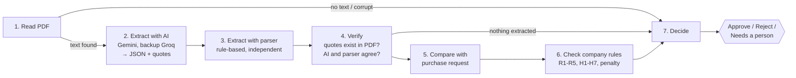

# Supplier Document Checker

An AI system that checks supplier quotations for a garment company **step by step** and **never guesses**.
For each supplier pack it reads the PDF, pulls out the key facts, compares them with the purchase request,
checks the company rules, and gives one of three answers — **Approve**, **Reject** or **Needs a person to
check** — with the rule that decided it and the exact quote from the document.

> BIAI AI Engineer — Round 2, Task 1. All companies and data are fictional sample files.

**Result on the 10 sample packs: 10 / 10 correct** in hybrid mode (Gemini + parser) and in parser-only mode
(see [Results](#results)).

---

## Contents
- [Quick start](#quick-start)
- [How it works](#how-it-works)
- [Results](#results)
- [Running it](#running-it)
- [Project structure](#project-structure)
- [Design choices](#design-choices)
- Further docs: [Architecture](docs/ARCHITECTURE.md) · [Rules & assumptions](docs/RULES_AND_ASSUMPTIONS.md) ·
  [Testing](docs/TESTING.md) · [Evaluation log](docs/EVALUATION_LOG.md) · [One-page note](NOTE.md) ·
  [How I used AI tools](docs/AI_TOOLS_USED.md)

---

## Quick start

Requires **Python 3.10+** (tested on 3.12, macOS). Check with `python3 --version`. macOS ships 3.9, which
is too old for LangGraph; if that's what you have, use the `uv` option below (it downloads 3.12 for this
project only).

```bash
git clone <this-repo> && cd supplier-doc-checker

# 1. Create an isolated environment (nothing is installed globally)
python3 -m venv .venv                       # needs Python 3.10+
source .venv/bin/activate                   # Windows: .venv\Scripts\activate
pip install -r requirements.txt

#    …or with uv, which works even if your system Python is older:
#    uv venv --python 3.12 .venv && source .venv/bin/activate && uv pip install -r requirements.txt

# 2. (Optional) add free API keys, then edit .env and paste them
#    Gemini (primary): https://aistudio.google.com/apikey
#    Groq (backup):    https://console.groq.com/keys
cp .env.example .env

# 3. Score all 10 sample packs
python -m supplier_checker.cli evaluate

# 4. Open the demo app
streamlit run app.py
```

**No API key?** Everything still runs: the system switches to *parser-only* mode (see [modes](#reading-modes)).
Either key alone is enough for the AI modes; with both, Groq is used only when Gemini fails.
You can force a mode with `--mode hybrid|ai|parser`.

---

## How it works

A fixed **LangGraph** workflow — seven steps that always run in the same order. There is no free-running
agent: the AI is used for **one** job (reading the document), and all decisions are made by plain,
testable Python.



**How "never guess" is enforced**

| Risk | What the system does |
|---|---|
| AI invents a value | Every AI value must come with a quote; the quote must appear **word-for-word** in the PDF. TIN/BIN numbers must literally be in the PDF. Otherwise → field marked *uncertain*. |
| AI misreads a number | A second, independent rule-based parser reads the same PDF. Any disagreement → *uncertain*. |
| A field is missing or uncertain | The rule that needs it returns **Needs a person to check**. It never assumes a value — e.g. an *uncertain* TIN does not cause a Reject, it goes to a person. |
| Ambiguous wording (e.g. "30 to 90 days as agreed") | Treated as unclear → Needs a person. |
| AI service down / quota exceeded | **Backup AI:** Gemini → Groq. Each call times out after 60 s; rate limits wait as long as the provider asks; errors that cannot succeed (daily quota, bad key, unknown model) skip straight to the next provider. If every AI fails: parser only **and** a person must check (not cross-checked). If no reader extracted anything, **no rule is run**: straight to a person. |
| Scanned or corrupt PDF | Stops after step 1 → Needs a person. |

**Decision order:** any Reject rule → **Reject**; otherwise any person-check rule → **Needs a person to check**;
otherwise → **Approve**. Every reason cites its rule ID (from `company-rules.md`) and the supporting quote.

---

## Results

Expected answers were worked out by hand from `company-rules.md` — see
[`data/expected-decisions.csv`](data/expected-decisions.csv) and [docs/TESTING.md](docs/TESTING.md).

| Pack | Supplier | Expected | Main reason | Hybrid (Gemini + parser) | Parser only |
|---|---|---|---|---|---|
| 01 | Padma Textile Mills | Approve | All checks pass | ✅ | ✅ |
| 02 | Jamuna Trims | Approve | All checks pass | ✅ | ✅ |
| 03 | Karnaphuli Yarn | Reject | R1: price 9.05% over max | ✅ | ✅ |
| 04 | Surma Packaging | Needs a person | H1: price 2.31% over max | ✅ | ✅ |
| 05 | Meghna Carton | Reject | R2: 40% advance | ✅ | ✅ |
| 06 | Teesta Fabrics | Reject | R3: no late-delivery penalty | ✅ | ✅ |
| 07 | Rupsha Zipper | Needs a person | H2: quantity −17.5% | ✅ | ✅ |
| 08 | Bhairab Thread | Reject | R4: TIN/BIN missing | ✅ | ✅ |
| 09 | Dhaleshwari Poly Pack | Needs a person | H3: payment "30 to 90 days"; H6: line total wrong | ✅ | ✅ |
| 10 | Kushiyara Box | Reject | R5: delivery 60 days (also H5: VAT not separate) | ✅ | ✅ |
| | | | **Total** | **10/10** (≈3 s/doc) | **10/10** (<0.05 s/doc) |

Model: `gemini-3.5-flash-lite`. In the hybrid run, the AI and the parser agreed on every field of every
document. The backup AI (Groq `openai/gpt-oss-120b`) also scored **10/10** on its own and in a live
fallback test where every Gemini call was made to fail. Earlier runs found two bugs, both fixed and covered by regression tests. Every run, including
the failed ones, is in [docs/EVALUATION_LOG.md](docs/EVALUATION_LOG.md).

Full per-document output (every check, every quote, step timings) is saved in `results/<mode>/`.

---

## Running it

### Command line
```bash
python -m supplier_checker.cli evaluate             # all 10, scored vs expected (default mode)
python -m supplier_checker.cli evaluate -v          # ...showing every step and every check
python -m supplier_checker.cli evaluate --mode parser
python -m supplier_checker.cli check data/supplier-pack-09.pdf          # one document
python -m supplier_checker.cli check data/supplier-pack-09.pdf --json   # full JSON result
```

### Web app
```bash
streamlit run app.py
```
- **Check all 10 samples** — runs the batch, shows the score and a table, and lets you inspect any document.
- **Check one document** — pick a sample or upload your own PDF.
- For *Needs a person to check* results, a reviewer can record their decision (saved to `results/review_log.jsonl`).

### Tests
```bash
python -m pytest -q        # 69 tests, offline, no API key needed
```

### Reading modes
| Mode | Readers | When to use |
|---|---|---|
| `hybrid` (default with key) | Gemini **and** parser, cross-checked | Best: two independent readers must agree |
| `ai` | Gemini only, quotes verified against PDF | Documents in layouts the parser does not know |
| `parser` (default without key) | Rule-based parser only | Offline / no key / reproducible baseline |

### Deploying (free working link)
1. Push this repo to GitHub.
2. On [share.streamlit.io](https://share.streamlit.io) → *New app* → pick the repo, main file `app.py`.
3. Under *Advanced settings → Secrets* add `GEMINI_API_KEY = "your-key"` (and optionally `GROQ_API_KEY`).

---

## Project structure

```
supplier-doc-checker/
├── app.py                        # Streamlit demo
├── supplier_checker/
│   ├── graph.py                  # LangGraph workflow: the 7 fixed steps
│   ├── documents.py              # PDF text extraction, purchase-request loader
│   ├── ai_reader.py              # Reader 1: LLM -> structured JSON (Gemini, backup Groq)
│   ├── parser_reader.py          # Reader 2: rule-based parser (independent cross-check)
│   ├── verify.py                 # Grounding (quotes exist) + agreement (AI vs parser)
│   ├── rules.py                  # Purchase-request comparison, company rules, decision
│   ├── schemas.py                # Pydantic models: Extraction, Finding, Decision
│   ├── config.py                 # Every threshold from company-rules.md, in one place
│   └── cli.py                    # check / evaluate commands
├── tests/test_pipeline.py        # 69 offline tests
├── data/                         # Sample files from BIAI + expected-decisions.csv
├── results/                      # Saved evaluation outputs per mode
├── docs/                         # Architecture, rules, testing, evaluation log, AI-tool log
└── NOTE.md                       # One-page note
```

---

## Design choices

1. **AI reads, Python decides.** The LLM only turns a PDF into structured facts. Rules like
   "price more than 3% over the maximum" are arithmetic, so they are plain code: predictable, explainable and
   unit-tested. An LLM deciding them would sometimes get them wrong, and we could not explain why.
2. **Two independent readers.** Gemini handles messy wording; the parser is exact on the known layout. When
   they agree we can trust the value; when they don't, a person checks. This turns "the AI might be wrong" into
   a measurable, visible signal.
3. **Quotes are mandatory and verified.** The rules say "always quote the exact text". We go further: a quote
   that is not literally in the PDF invalidates the value.
4. **Uncertain ≠ missing.** "We could not read the BIN" and "there is no BIN" lead to different answers
   (person vs. reject). Mixing them up would be a guess.
5. **Fixed graph, two safety exits.** The only branches are "could the PDF be read?" and "did any reader
   extract anything?". Otherwise every step always runs, so every document gets a complete checklist, not
   just the first failure.
6. **All thresholds in `config.py`.** If the company changes a rule, one line changes.
7. **Gemini** (`gemini-3.5-flash-lite`) because it has a free API tier, so reviewers can run the full system at
   no cost. Its free tier allows only **20 requests/day per model**, so **Groq** (`openai/gpt-oss-120b`,
   about 1,000 requests/day free) is the backup. Override with `GEMINI_MODEL`, `GROQ_MODEL`, or
   `AI_PROVIDERS=groq,gemini` in `.env`.

See [docs/RULES_AND_ASSUMPTIONS.md](docs/RULES_AND_ASSUMPTIONS.md) for how each rule was interpreted.
